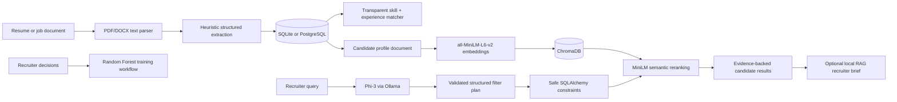

# TalentIQ — AI Hiring Intelligence

> A local-first talent intelligence platform for structured resume intake, transparent candidate-role matching, semantic candidate discovery, and evidence-grounded recruiter assistance.

TalentIQ helps recruiters turn resumes and job descriptions into structured, searchable evidence. It is built as **decision support**: the system explains signals and retrieves evidence, while final hiring decisions remain with people.

## Project ownership and credits

**Primary implementation and technical ownership:**

- **Aditya Vikram** — product architecture, backend implementation, AI/ML integration, retrieval pipeline, frontend experience, data model, testing, and demo workflow.

**Academic project team:**

- Aditya Vikram — Registration No. `240905562` · Roll No. `56`
- Hrit Singh — Registration No. `240905452` · Roll No. `43`
- Yoovan Pattnaik — Registration No. `240905632` · Roll No. `64`

Department of Computer Science and Engineering, Manipal Institute of Technology, MAHE.

---

## What the project does

| Capability | What it delivers |
|---|---|
| Resume and JD intake | Extracts text from PDF/DOCX files and creates structured candidate or job records. |
| Structured profile extraction | Captures known skills, experience, education, projects, certifications, and work history. |
| Transparent role matching | Ranks candidates from required-skill coverage and minimum-experience fit. |
| Explainable candidate insights | Shows matched/missing skills, score components, strengths, gaps, and a human-review note. |
| Semantic candidate search | Uses MiniLM embeddings and ChromaDB to retrieve conceptually relevant candidate profiles. |
| Local LLM query planning | Uses Phi-3 through Ollama to interpret natural-language constraints into a validated filter plan. |
| Hybrid retrieval | Applies safe SQLAlchemy filters first, then semantically reranks the eligible profiles. |
| Grounded RAG brief | Optionally creates a local recruiter brief using only retrieved stored evidence. |
| Recruiter feedback loop | Saves shortlist/interview/reject decisions per candidate-job pair. |
| Supervised ML workflow | Trains a Random Forest from recruiter decisions and exposes sample counts, feature importances, MAE, and R². |

## AI / ML stack



### Models and safeguards

- **Embeddings:** `sentence-transformers/all-MiniLM-L6-v2`, stored locally in ChromaDB.
- **Local LLM:** `phi3:mini` served by Ollama for query planning and optional grounded generation.
- **No raw LLM SQL:** Phi-3 produces a typed plan; the backend validates it and generates SQLAlchemy predicates itself.
- **Structured constraints:** Supports minimum/maximum experience, `AND`, `OR`, `XOR`, and excluded skills.
- **Grounding:** RAG prompts provide stored skills, projects, work history, and years of experience only.
- **Human oversight:** Explanations and fairness notes are included; TalentIQ is not an automated hiring decision-maker.

## Current implementation status

| Status | Item |
|---|---|
| Implemented | Resume/job parsing, structured extraction, candidate CRUD, job CRUD, matching, explainable score breakdown, pipeline stages, recruiter decisions. |
| Implemented | MiniLM semantic search, ChromaDB index refresh, local Phi-3 query planning, hybrid SQL + semantic retrieval, optional local RAG brief. |
| Implemented | Random Forest training/status/dataset APIs based on recruiter decision labels. |
| Planned | SHAP per-prediction explanations, formal bias metrics, learned model as the primary live ranker, authentication, production deployment. |

> The bundled demo data is synthetic. It proves the workflow and should not be presented as real candidate data or a real-world model-quality benchmark.

---

## Quick start (Windows)

### 1. Install prerequisites

- Python 3.11+ with a virtual environment
- Node.js 20+
- Ollama, for local LLM features

### 2. Set up Python dependencies

```powershell
cd C:\path\to\AI_Hiring_Copilot
.\venv\Scripts\Activate.ps1
pip install -r requirements.txt
```

### 3. Configure local environment

Create `.env` in the repository root:

```env
DATABASE_URL=sqlite:///./talentiq_demo.db
EMBEDDING_LOCAL_ONLY=true
OLLAMA_BASE_URL=http://127.0.0.1:11434
OLLAMA_MODEL=phi3:mini
```

`EMBEDDING_LOCAL_ONLY=true` keeps the demo stable by using the already downloaded MiniLM model instead of retrying remote model checks.

### 4. Prepare the demo dataset

```powershell
.\venv\Scripts\python.exe scripts\seed_demo_data.py
```

This idempotent script creates or updates:

- 20 detailed synthetic candidate profiles
- 5 synthetic technical and non-technical job roles
- 12 synthetic recruiter-decision labels
- A local Random Forest training artifact

### 5. Prepare local generation

```powershell
ollama pull phi3:mini
```

Open Ollama once if its service is not already running.

### 6. Start the backend

```powershell
.\venv\Scripts\python.exe -m uvicorn main:app --host 127.0.0.1 --port 8001
```

- API health: <http://127.0.0.1:8001/>
- Swagger/OpenAPI: <http://127.0.0.1:8001/docs>

### 7. Start the frontend in a second terminal

```powershell
cd frontend
npm install
npm run dev
```

Open <http://127.0.0.1:5173/>.

---

## Demo script

1. Open **Candidates** to inspect structured profiles and pipeline stages.
2. Open **Roles** and choose a job to see the ranked shortlist.
3. Open a candidate insight to show the weighted score breakdown, matched skills, gaps, and recommendation context.
4. Open **AI Intelligence** and search for `python fastapi backend`.
5. Run this hybrid filter demo:

   ```text
   Find candidates with exactly one of Python or Java and at least 3 years of experience.
   ```

6. Open **AI pipeline trace** to show: Phi-3 plan → validated SQL filter → MiniLM/Chroma reranking → retrieved evidence.
7. Select **Generate local brief** to demonstrate grounded local RAG.
8. For ML workflow evidence, open `/docs` and inspect `/api/v1/ml/ranking/status`.

## Explainable baseline score

For a job with a minimum experience requirement:

```text
skill_coverage = matched required skills / total required skills
experience_score = 1 when candidate experience meets the requirement, otherwise 0
match_score = 100 × (0.8 × skill_coverage + 0.2 × experience_score)
```

For roles with no experience requirement, the score uses skill coverage only. The UI exposes the inputs and weighted contributions rather than hiding the result behind a black-box score.

## API overview

| Group | Example endpoints |
|---|---|
| Candidates | `POST /api/v1/candidates/`, `GET /api/v1/candidates/`, `GET /api/v1/candidates/semantic-search` |
| Resumes | `POST /api/v1/resumes/extract` |
| Jobs | `POST /api/v1/jobs/`, `GET /api/v1/jobs/{job_id}/candidates`, `POST /api/v1/jobs/extract` |
| Candidate insights | `GET /api/v1/jobs/{job_id}/candidates/{candidate_id}/insights` |
| Recruiter decisions | `PUT /api/v1/jobs/{job_id}/candidates/{candidate_id}/decision` |
| AI intelligence | `POST /api/v1/ai/recruiter-brief`, `POST /api/v1/ai/reindex`, `GET /api/v1/ai/runtime-check` |
| ML evaluation | `GET /api/v1/ml/ranking/status`, `GET /api/v1/ml/ranking/dataset`, `POST /api/v1/ml/ranking/train` |

## Database entities

- `candidates` — profiles, structured extraction fields, pipeline state, and recruiter notes
- `jobs` — role details, required skills, requirements, and minimum experience
- `resumes` — uploaded-file metadata
- `candidate_job_decisions` — one recruiter outcome per candidate-job pair
- ChromaDB `candidate_profiles` — derived MiniLM vectors; the relational database remains the source of truth

## Testing

```powershell
.\venv\Scripts\python.exe -m pytest -q
```

Build the frontend:

```powershell
cd frontend
npm run build
```

## Project structure

```text
app/
  api/v1/endpoints/     FastAPI routes
  models/               SQLAlchemy data model
  services/             extraction, matching, AI, retrieval, ML services
  schemas/              request/response contracts
alembic/                database migrations
frontend/               React + TypeScript + Vite application
scripts/seed_demo_data.py  reproducible synthetic demo workspace
docs/                   synopsis alignment and report context
tests/                  backend integration/unit tests
```

## Academic integrity and responsible use

- Use only authorised, de-identified, or synthetic data in academic demonstrations.
- Do not use protected characteristics for ranking or decision-making.
- Treat model output as evidence to review, not a substitute for a recruiter.
- Report synthetic-data limitations, local model limitations, and unfinished fairness/SHAP work honestly.

## License

Academic project repository. Add an explicit license before reuse outside the course context.
