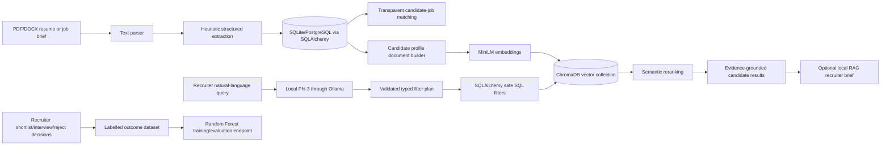

# TalentIQ Report Context Pack

> **Purpose:** Give this entire file to the AI that will prepare the mini-project report. It contains verified project facts, the required report structure, source material, and guardrails against inaccurate claims. Create the final `.docx` by filling the prescribed IEEE full-paper template supplied by the course, not by redesigning the document from scratch.

## 1. Non-negotiable writing instructions

- Write fresh, original prose from the facts below. Do not copy this pack verbatim and do not copy abstracts or paragraphs from papers.
- Use IEEE in-text citations such as `[1]` and include only sources actually cited in the body.
- Do **not** claim that SHAP, fine-tuning, protected-attribute fairness metrics, a cloud LLM, or a production deployment are implemented; they are not part of the current build.
- Do **not** fabricate accuracy, precision, recall, F1-score, latency, or user-study results. If a metric has not been measured, state the evaluation plan or leave a clearly marked placeholder.
- Describe TalentIQ as a **recruiter decision-support system**, never as an autonomous hiring or rejection system.
- Clearly mark the included records as **synthetic demo data**. Do not present the 20 seeded profiles as a public benchmark dataset or real applicants.
- Keep personally identifiable data out of screenshots and appendices. Use demo/synthetic profiles in demonstrations.

## 2. IEEE template and final report constraints

- Required template: <https://attend.ieee.org/procomm-2024/wp-content/uploads/sites/580/2024/03/Full-Paper-template.docx>
- Required sections: Title, Abstract, Keywords, Introduction, Literature Survey, Objectives, Data Source, Methodology, Implementation Details, Results and Discussion, Conclusion and Future Scope, References.
- The final report must contain a front page with School, College name/logo, project title, team members, roll numbers, registration numbers, faculty guide(s), and academic year.
- Target a low similarity report by writing from project evidence in original language, giving citations for ideas from literature, and avoiding copied paper text. Do not attempt to game Turnitin.

## 3. Front-page facts

| Item | Value |
|---|---|
| Project title | **TalentIQ: An AI-Powered Talent Intelligence and Candidate Evaluation Platform** |
| Department | Department of Computer Science and Engineering |
| College | Manipal Institute of Technology (MIT), Manipal Academy of Higher Education (MAHE) |
| Location | Udupi, Karnataka, India |
| Team member 1 | Aditya Vikram — Registration No. 240905562 — Roll No. 56 |
| Team member 2 | Hrit Singh — Registration No. 240905452 — Roll No. 43 |
| Team member 3 | Yoovan Pattnaik — Registration No. 240905632 — Roll No. 64 |
| School name | **[Confirm and insert official School name]** |
| Faculty guide(s) | **[Confirm and insert name(s), designation(s), department]** |
| Academic year | **[Confirm with department; do not infer]** |
| College logo | Insert the official MIT/MAHE logo supplied or approved by the college |

## 4. Project one-line description

TalentIQ is a local-first web application that ingests resumes and job descriptions, extracts structured hiring information, computes transparent candidate-role fit, supports semantic candidate retrieval, and can generate evidence-grounded recruiter briefs using local models.

## 5. Ready-to-adapt abstract facts

Use the following as source material; rewrite it in original prose for the final paper.

TalentIQ addresses the practical difficulty of reviewing many resumes while preserving recruiter oversight. The system accepts PDF or DOCX resumes and job descriptions, extracts structured candidate and role information, and stores those records in a relational database. A transparent baseline ranks candidates from required-skill coverage and minimum-experience satisfaction. For semantic discovery, candidate profiles are embedded with `sentence-transformers/all-MiniLM-L6-v2` and indexed in ChromaDB. A local Phi-3 model, served through Ollama, interprets recruiter queries into a typed filter plan; the application validates that plan, compiles it safely through SQLAlchemy, and uses MiniLM to rerank only eligible profiles. The same local model can produce an optional recruiter brief grounded only in retrieved evidence. A separate Random Forest training pipeline can learn from recorded recruiter decisions after adequate labelled feedback exists. The current demonstration uses 20 realistic synthetic candidate profiles, five synthetic job roles, and synthetic recruiter-decision labels. TalentIQ is designed as explainable decision support: final hiring decisions remain with human recruiters.

### Suggested keywords

Artificial Intelligence; Talent Intelligence; Resume Parsing; Semantic Search; Sentence Embeddings; Retrieval-Augmented Generation; Explainable AI; Candidate Ranking; Human-in-the-Loop Recruitment.

## 6. Problem statement and motivation

Conventional resume screening is time-consuming and often relies on literal keyword matches. Literal matching can miss candidates whose relevant experience is described with different terms, while opaque automation can make it hard for recruiters to understand rankings. TalentIQ combines structured extraction, transparent rule-based matching, semantic retrieval, retrieval-grounded generation, and recruiter feedback capture. Its aim is to reduce search effort while retaining evidence, transparency, and human review.

## 7. Objectives

Use these objectives in the report, distinguishing completed work from future work where necessary.

1. Extract structured fields—skills, education, experience, projects, certifications, and work history—from resumes and job descriptions. **Implemented.**
2. Compare candidate and job profiles through skill and experience signals. **Implemented.**
3. Rank candidates for a selected role with a transparent baseline score. **Implemented.**
4. Identify missing required skills and experience gaps. **Implemented.**
5. Support semantic candidate discovery through profile embeddings and a vector database. **Implemented.**
6. Support natural-language recruiter queries and evidence-grounded retrieval briefs. **Implemented locally.**
7. Capture recruiter outcomes and provide a supervised ranking-model training path. **Implemented; learned model is trained/evaluated separately and is not the primary live ranker.**
8. Add SHAP-based per-prediction attributions and formal fairness measurement. **Future work, not implemented.**

## 8. Data source and ethical handling

### Data currently used in the implemented demonstration

| Dataset component | Verified implementation detail |
|---|---|
| Candidate profiles | 20 detailed **synthetic** profiles created by `scripts/seed_demo_data.py` |
| Roles | 5 **synthetic** job openings: Senior Backend Engineer, Machine Learning Engineer, Product Designer, People Operations Partner, Revenue Operations Manager |
| Domains | Technical and non-technical roles, including backend, ML, design, people operations, revenue operations, finance, content, customer success, security, and operations |
| Decision labels | 12 synthetic recruiter-decision records with `shortlisted`, `interview`, or `rejected` outcomes; used only to exercise the ML workflow |
| Uploaded documents | Users may upload their own PDF/DOCX resumes and job descriptions locally for extraction |

### Important wording for the report

- State that the supplied demo profiles and labels are synthetic and intended for functional testing, controlled demonstrations, and reproducibility.
- State that the present report does not claim performance on a public benchmark dataset unless the team separately runs, documents, and cites such an experiment.
- If public data is added later, document source URL, licence, collection date, fields retained, data-cleaning steps, and de-identification method.
- Do not use protected traits for matching. The current scoring uses stated role skills and experience; recruiter review remains mandatory.

## 9. System architecture



## 10. Methodology

### 10.1 Document ingestion and structured extraction

1. The user uploads a PDF or DOCX file.
2. `pypdf` or `python-docx` extracts plain text.
3. A heuristic extraction service identifies email, Indian-format phone number, first plausible name line, known skills, years of experience, and section headings.
4. The service stores education, projects, certifications, and work-history lines when their section headings are detected.
5. Extraction metadata records parser version, extracted fields, and source-character count.

**Accuracy caveat:** This is deterministic heuristic NLP (`heuristic-v1`), not an LLM resume parser. The report should discuss possible errors in unusual layouts, multi-column PDFs, and vocabulary outside the current skill catalogue.

### 10.2 Transparent candidate-job matching

- Skills are normalized with aliases such as `py → python`, `js → javascript`, `postgres → postgresql`, and `sklearn → scikit-learn`.
- If a job has no minimum-experience requirement, the score is entirely skill coverage.
- If a job has a minimum-experience requirement, the score uses **80% required-skill coverage + 20% experience satisfaction**.
- Output includes matched skills, missing skills, experience result, score breakdown, strengths, weaknesses, and a human-review fairness note.

Formula for a role with required skills:

```text
skill_coverage = matched_required_skills / total_required_skills
experience_score = 1 if candidate_years >= required_years else 0
match_score = 100 × (0.8 × skill_coverage + 0.2 × experience_score)
```

### 10.3 Semantic retrieval

- Candidate information is combined from name, skills, education, projects, certifications, work history, years of experience, and source text.
- The system encodes these documents with `sentence-transformers/all-MiniLM-L6-v2` and L2-normalizes embeddings.
- Vectors are persisted in ChromaDB in a `candidate_profiles` collection with cosine distance.
- Changes are detected through a SHA-256 document hash; only changed profiles are re-embedded.
- The UI can refresh/reindex the knowledge base.

### 10.4 LLM-assisted query planning and hybrid retrieval

- Local model: `phi3:mini`, served through Ollama; no cloud API key is required.
- Phi-3 converts a recruiter query into JSON fields: `min_experience`, `max_experience`, `skills`, `skill_operator` (`AND`, `OR`, `XOR`), `excluded_skills`, and `semantic_query`.
- The application validates types and only accepts skills present in the stored vocabulary.
- The LLM does not emit or execute SQL. A backend service compiles the validated plan to parameterized SQLAlchemy predicates.
- SQL filters enforce exact experience, AND/OR/XOR skill conditions, and exclusions; MiniLM then reranks only the rows that passed those constraints.
- Example: “exactly one of Python or Java with at least 3 years” becomes a minimum-experience filter plus an XOR skill predicate, so a profile with both skills is excluded.

### 10.5 Retrieval-augmented generation

- Retrieval is always performed before generation.
- The optional recruiter brief receives only the top retrieved candidate evidence: name, listed skills, and retrieval explanation.
- The prompt explicitly prohibits invented experience, protected-trait inference, and autonomous hiring decisions.
- If Ollama is unavailable, the system returns a grounded deterministic summary or retrieval-only result rather than failing.

### 10.6 Supervised learning pipeline

- Recruiters can record one decision per candidate-job pair: `shortlisted`, `interview`, or `rejected`.
- Labels map to `0.7`, `1.0`, and `0.0` respectively for a regression training target.
- Model: `RandomForestRegressor(n_estimators=200, random_state=42, min_samples_leaf=1)`.
- Features: skill coverage, experience coverage, project count, certification count, profile completeness, and baseline match score.
- Minimum training condition: at least 6 labelled decisions and at least 2 distinct outcome classes.
- When at least 8 labelled records exist, the pipeline also produces holdout MAE and R². Feature importances are stored with model metadata.

**Critical limitation:** The trained Random Forest is an evaluation/training component in the present system. The main live ranking remains the transparent baseline; do not claim live ML ranking unless that integration is completed and verified.

## 11. Implementation details

| Layer | Technology / implementation |
|---|---|
| Backend | Python, FastAPI, Uvicorn |
| Relational persistence | SQLAlchemy; SQLite is the local default and PostgreSQL is supported through `psycopg2-binary` |
| Schema evolution | Alembic migrations |
| Document parsing | `pypdf`, `python-docx` |
| Semantic model | `sentence-transformers/all-MiniLM-L6-v2` |
| Vector database | ChromaDB persistent collection |
| Local LLM runtime | Ollama with `phi3:mini` |
| Supervised ML | scikit-learn Random Forest and joblib artifact storage |
| Frontend | React, TypeScript, Vite, Lucide icons |
| API documentation | FastAPI OpenAPI/Swagger at `/docs` |

### Core relational entities

- `candidates`: identity/contact fields, experience, skills, structured sections, source text, extraction metadata, pipeline stage, and notes.
- `jobs`: title, description, minimum experience, skills, requirements, and timestamps.
- `resumes`: uploaded-file metadata linked optionally to a candidate.
- `candidate_job_decisions`: one decision per candidate-job pair; supports the ML feedback dataset.

### Useful API groups for the report appendix

| API group | Example capability |
|---|---|
| `/api/v1/resumes/extract` | Upload and extract a candidate profile from PDF/DOCX |
| `/api/v1/jobs/extract` | Upload and extract a job profile from PDF/DOCX |
| `/api/v1/candidates/semantic-search` | Candidate semantic-search route |
| `/api/v1/jobs/{job_id}/candidates` | Role-specific candidate ranking |
| `/api/v1/ai/recruiter-brief` | Hybrid retrieval and optional local RAG brief |
| `/api/v1/ai/reindex` | Refresh ChromaDB candidate embeddings |
| `/api/v1/ml/ranking/dataset` | Inspect labelled ML dataset |
| `/api/v1/ml/ranking/train` | Train the Random Forest from decisions |
| `/api/v1/ml/ranking/status` | Read training sample count, metrics, and feature importance |

## 12. Results and discussion: safe evidence to report

### Demonstrable functional results

The report may state the following, because they are directly supported by the source code and demo seed:

- The controlled demo seed provides 20 detailed synthetic candidate profiles spanning technical and non-technical roles.
- It provides 5 synthetic job descriptions and 12 synthetic recruiter-decision records.
- Resume/job uploads produce structured fields that can be reviewed and edited in the application.
- Candidate-role ranking exposes matched skills, missing skills, experience satisfaction, and weighted score contributions.
- MiniLM embedding search retrieves candidates from ChromaDB, while the interface identifies whether vector retrieval or lexical fallback was used.
- Natural-language filters can be displayed as an audit trace: local LLM plan, validated constraints, safe SQL compilation, retrieval, and optional local generation.
- The ML service records the training sample count, model feature importance, MAE, and R² when enough decisions are available.

### Results table to complete during final testing

Do not invent these values. Run the listed command/API call, capture a screenshot, and insert the observed output.

| Evaluation item | Procedure | Result to insert |
|---|---|---|
| Resume extraction | Upload 3–5 representative PDF/DOCX files and manually compare fields | `[manual field-level observations]` |
| Job extraction | Upload 2–3 job documents and inspect skills/requirements/experience | `[manual observations]` |
| Candidate-role ranking | Select each seeded role and inspect top candidates and score breakdown | `[top-k examples]` |
| Semantic retrieval | Search domain queries such as “Python API engineer”, “revenue forecasting”, “recruiter workflow” | `[retrieved candidates and relevance observations]` |
| Hybrid constraint query | Search “exactly one of Python or Java with at least 3 years” | `[returned count; verify profiles with both skills are excluded]` |
| RAG grounding | Run retrieval, then “Generate local brief”; compare every sentence with retrieved evidence | `[grounding review]` |
| ML training | `POST /api/v1/ml/ranking/train`, then `GET /api/v1/ml/ranking/status` | `[samples, MAE, R² if available, feature importances]` |
| Runtime | Record semantic-search latency after warmup and on repeated query | `[measured ms and machine specification]` |

### Discussion points

- The baseline is easy to interpret, but it cannot recognize all synonymous skills or nuanced work-history evidence.
- Semantic embeddings improve recall for related descriptions but may retrieve superficially related profiles; structured filters are therefore applied first when the query contains explicit constraints.
- Local Phi-3 avoids a cloud API dependency and enables a traceable query plan, but cold-start/query-plan latency can be noticeable on CPU hardware.
- Synthetic labels prove the end-to-end ML workflow, not real hiring effectiveness or fairness.
- The application deliberately keeps a human recruiter in the decision loop.

## 13. Limitations and future scope

### Current limitations

1. The initial extraction service is heuristic and has a finite skill vocabulary.
2. The demo dataset and recruiter labels are synthetic; they cannot establish real-world generalization.
3. The Random Forest is trainable but is not yet connected as the production ranking mechanism.
4. The current explanations are score-component and feature-importance explanations, not SHAP values.
5. There is no formal bias audit, calibration study, authentication layer, multi-user role control, or deployment benchmark in the verified implementation.
6. Semantic search quality depends on profile text quality, embedding model suitability, and local compute availability.

### Future scope

- Evaluate with a licensed, de-identified public resume/job dataset and report retrieval/ranking metrics.
- Add SHAP-based local feature attributions for trained ranking predictions.
- Add explicit fairness evaluation, data-governance controls, consent handling, and audit logs.
- Integrate and evaluate the learned ranking model behind a recruiter-controlled comparison mode.
- Improve document extraction with layout-aware NLP/OCR for difficult resumes.
- Add authentication, role-based access, encrypted storage, and a production deployment pipeline.
- Compare local models/embedding models for latency, retrieval quality, and cost.

## 14. Suggested IEEE reference starters

Verify the final formatting against the cited source pages and cite only works used in the paper.

```text
[1] N. Reimers and I. Gurevych, “Sentence-BERT: Sentence Embeddings using Siamese BERT-Networks,” in Proceedings of EMNLP-IJCNLP, 2019, pp. 3982–3992, doi: 10.18653/v1/D19-1410.

[2] S. M. Lundberg and S.-I. Lee, “A Unified Approach to Interpreting Model Predictions,” in Advances in Neural Information Processing Systems 30, 2017.

[3] M. Köchling and M. C. Wehner, “Discriminated by an algorithm: a systematic review of discrimination and fairness by algorithmic decision-making in the context of HR recruitment and HR development,” Business Research, vol. 13, pp. 795–848, 2020, doi: 10.1007/s40685-020-00134-w.

[4] M. Raghavan, S. Barocas, J. M. Kleinberg, and K. Levy, “Mitigating Bias in Algorithmic Hiring: Evaluating Claims and Practices,” in Proceedings of FAT* ’20, 2020, doi: 10.1145/3351095.3372828.

[5] Chroma, “Chroma Documentation.” [Online]. Available: https://docs.trychroma.com/. [Accessed: insert date].

[6] Ollama, “Ollama Documentation.” [Online]. Available: https://docs.ollama.com/. [Accessed: insert date].
```

## 15. Final prompt for the report-writing AI

```text
Create an original IEEE-style mini-project report in the official DOCX template for the project “TalentIQ: An AI-Powered Talent Intelligence and Candidate Evaluation Platform.” Use the attached context pack as the factual source of truth. Include every section required by the faculty: Title, Abstract, Keywords, Introduction, Literature Survey, Objectives, Data Source, Methodology, Implementation Details, Results and Discussion, Conclusion and Future Scope, and References. Add a separate front page with the supplied team data and leave clearly labelled placeholders for School name, faculty guide(s), academic year, and approved college logo.

Use fresh prose and IEEE citations. Do not fabricate metrics, datasets, SHAP results, fairness results, cloud APIs, or production deployment. The current demo uses 20 synthetic candidate profiles, 5 synthetic jobs, and 12 synthetic recruiter decisions. Clearly distinguish implemented components from future work. Include the architecture and methodology faithfully, especially the local Phi-3 -> validated filter plan -> safe SQLAlchemy filters -> MiniLM/Chroma reranking -> optional local RAG flow. State that the system is decision support and final recruitment decisions remain human-controlled.
```

## 16. Project evidence locations

- Synopsis alignment and integrity notes: `docs/SYNOPSIS_ALIGNMENT.md`
- Demo dataset/reproducibility script: `scripts/seed_demo_data.py`
- Extraction: `app/services/extraction_service.py`
- Matching/explanations: `app/services/matching_service.py`, `app/services/insight_service.py`
- Semantic retrieval: `app/services/vector_search_service.py`
- Query planning: `app/services/query_planning_service.py`
- Grounded generation: `app/services/ai_retrieval_service.py`
- ML training: `app/services/ranking_model_service.py`
- API routes: `app/api/v1/endpoints/`
- React user interface: `frontend/src/App.tsx`
